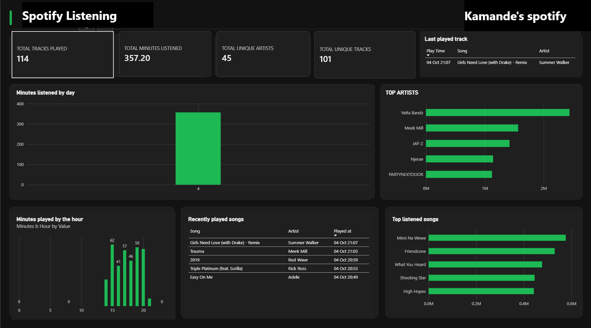

# Spotify Real-Time Data Engineering Pipeline

An end-to-end data engineering pipeline that captures Spotify listening activity in near real time, streams events through Kafka, stores raw data in S3-compatible object storage, loads it into PostgreSQL, transforms it with dbt, and visualizes the resulting analytics in Power BI.

The entire pipeline runs locally using Docker.

## Project Overview

The pipeline polls the Spotify Web API, detects newly played tracks, and publishes each play as an event.

Events flow through Kafka into SeaweedFS as raw JSONL files, are loaded into PostgreSQL, transformed into analytics-ready models with dbt, and consumed by Power BI for reporting.

The dashboard provides insights into:

* Daily listening trends
* Listening patterns by hour and weekday
* Top artists and tracks
* Listening time
* Genre distribution
 

## Architecture

```text
Spotify API
     |
     v
  Producer
     |
     v
   Kafka
     |
     v
  Consumer
     |
     v
SeaweedFS (S3)
  Raw JSONL
     |
     v
   Loader
     |
     v
PostgreSQL
  Raw Schema
     |
     v
    dbt
     |
     v
Analytics Schema
     |
     v
 Power BI
```

## Tech Stack

| Component        | Technology                       |
| ---------------- | -------------------------------- |
| Ingestion        | Python, Spotipy, Spotify Web API |
| Streaming        | Apache Kafka (KRaft mode)        |
| Raw Storage      | SeaweedFS (S3 API)               |
| Data Warehouse   | PostgreSQL 16                    |
| Transformation   | dbt Core, dbt-postgres           |
| Genre Enrichment | MusicBrainz API                  |
| Visualization    | Power BI Desktop                 |
| Infrastructure   | Docker Compose                   |

## Setup

### Prerequisites

* Docker Desktop
* Python 3.10+
* Spotify Developer application
* Power BI Desktop

Configure the Spotify application with the following redirect URI:

```text
http://127.0.0.1:8888/callback
```

### Installation

```bash
cp .env.example .env
```

Add your Spotify credentials and PostgreSQL password to `.env`.

Create and activate the Python virtual environment:

```bash
python -m venv .venv
source .venv/Scripts/activate
```

Install the required dependencies:

```bash
pip install -r requirements.txt
```

Start the infrastructure:

```bash
docker compose up -d
```

## Running the Pipeline

Run each service in a separate terminal with the virtual environment activated.

### 1. Spotify Producer

```bash
python producer/spotify_producer.py
```

On the first run, the application opens a browser for Spotify OAuth authorization.

The producer polls Spotify and publishes newly detected plays to Kafka.

### 2. Kafka Consumer

```bash
python consumer/kafka_to_seaweedfs.py
```

The consumer reads Kafka events and writes them to SeaweedFS as raw JSONL files.

### 3. PostgreSQL Loader

```bash
python loader/s3_to_postgres.py --watch
```

The loader continuously monitors object storage and loads new events into PostgreSQL.

New listening events typically reach PostgreSQL within approximately two minutes.

Run only one instance of each service to avoid duplicate processing.

## dbt Transformation

Navigate to the dbt project and load the required environment variables:

```bash
set -a
source .env
set +a

cd spotify_dbt
```

Run the dbt workflow:

```bash
dbt seed --profiles-dir .
dbt run --profiles-dir .
dbt test --profiles-dir .
```

dbt transforms the raw listening events into staging, fact, dimension, bridge, and aggregate models used by Power BI.

## Data Model

| Model                  | Type      | Description                                                              |
| ---------------------- | --------- | ------------------------------------------------------------------------ |
| `stg_spotify_events`   | Staging   | Cleaned and typed Spotify events                                         |
| `stg_artist_genres`    | Staging   | Artist genre information and broad genre groups                          |
| `fct_listening_events` | Fact      | One row per listening event with local time and estimated listening time |
| `fct_event_artists`    | Bridge    | Links listening events to credited artists                               |
| `dim_tracks`           | Dimension | One row per track                                                        |
| `dim_artists`          | Dimension | One row per artist with genre information                                |
| `agg_daily_listening`  | Aggregate | Listening plays and minutes by day                                       |
| `agg_hourly_listening` | Aggregate | Listening plays and minutes by weekday and hour                          |
| `agg_genre_listening`  | Aggregate | Listening plays and minutes by genre group                               |

## Power BI

Connect Power BI Desktop to PostgreSQL using:

```text
Host: localhost
Port: 5433
Database: spotify_dw
Schema: analytics
```

Import the required analytics models.

### Relationships

Create the following relationships:

```text
fct_listening_events[track_id]
        |
        v
dim_tracks[track_id]


fct_event_artists[event_id]
        |
        v
fct_listening_events[event_id]


fct_event_artists[artist_id]
        |
        v
dim_artists[artist_id]
```

Keep the `agg_*` tables unrelated to the main fact/dimension model.

## Key Analytics

The Power BI dashboard can be used to analyze:

* Total plays
* Estimated listening minutes
* Daily listening trends
* Peak listening hours
* Weekday vs. weekend behavior
* Top artists
* Top tracks

## Limitations

* The pipeline only captures plays while the producer is running.
* Spotify's recently played endpoint provides a limited recent history rather than a complete historical listening record.
* Listening time is estimated using the gap between consecutive plays, so pauses, skips, and other interruptions can affect the estimate.
* The current pipeline requires the services to be started manually.
* Time recorded in the original spotify format (milliseconds), with time the graphs will need conversion to minutes/hours.
      1 second = 1,000 milliseconds 
      1 minute = 60 seconds 
      1 minute = 60,000 milliseconds

* Genres: Failed to pick all artists genres
* The minutes played by day visual in powerbi will update by day,everyday - currently just one bar.

## Roadmap

Planned improvements include:

* Historical backfill using Spotify Extended Streaming History
* Airflow orchestration
* Incremental dbt models
* Automated service startup
* Improved listening-duration calculation
* Additional data quality monitoring
* Genres: Streams genres and add them for better music visuals and analysis

## Author

**Chege Dennis Kamande**
Data Engineering / Data Analytics

GitHub: https://github.com/denniskamande
Portfolio: https://kamande.vercel.app

